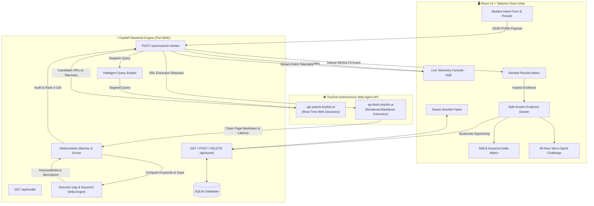

# 🎯 Opportunity Agent — From Intent to Opportunity

<div align="center">


**An autonomous AI agent pipeline integrating TinyFish Web Agents with deterministic, zero-hallucination eligibility auditing.**

[](https://python.org)
[](https://fastapi.tiangolo.com)
[](https://react.dev)
[](https://vitejs.dev)
[](https://tailwindcss.com)
[](https://tinyfish.ai)
[](https://sqlite.org)
[](LICENSE)

**Team Name:** The MetaMinds &nbsp;|&nbsp; **Hackathon:** TinyFish Autonomous Web Agents Hackathon

[Key Features](#-key-features) • [System Architecture](#-system-architecture) • [Getting Started](#-getting-started) • [API Reference](#-api-reference) • [Audit Engine](#-deterministic-audit-engine)

</div>

---

## 💡 The Problem

Every year, students and early-career developers waste **hundreds of hours** scouring scattered portals, outdated job boards, and dead-end hackathon aggregates:
- **Expired Deadlines:** Crawlers and aggregators index pages that closed weeks ago.
- **LLM Hallucinations:** Generic chat assistants fabricate deadlines, qualification criteria, and stipend numbers because they cannot inspect the live web reliably.
- **Hidden Eligibility Barriers:** Listings rarely match the candidate's exact education level, tech stack, or visa/work mode constraints.

## 🚀 The Solution: Opportunity Agent

**Opportunity Agent** bridges the gap between raw student intent and verified opportunities:
1. **Autonomous Web Traversal:** Leverages the **TinyFish Search and Fetch APIs** to perform live, autonomous web crawling and page extraction across official competition portals and engineering internships.
2. **Deterministic, Zero-Hallucination Audit:** Rather than allowing an LLM to guess eligibility, our deterministic audit engine inspects markdown extractions directly for skills, geographic restrictions, work modes, and explicit deadlines.
3. **Live SSE Telemetry Streaming:** Streams real-time HTTP hops, latencies, and crawl events straight into an editorial, Dropbox-inspired terminal console.
4. **Actionable Roadmap & Evidence Citations:** Each candidate opportunity includes verbatim source citations, match scores (`0-100`), and a tailored 3-step action checklist.
5. **Persistent Shortlist:** One-click persistence to an integrated SQLite database for candidate tracking.

---

## ✨ Key Features

### 1. Dropbox-Inspired Editorial Design System
Crafted with high visual hierarchy, clean grid discipline, sharp contrast, and purposeful typography:
- **Obsidian Canvas (`#101010` / `#161616`)** with elevated slate card surfaces (`#1E1E1E`, `#242424`).
- **Brand Accents:** Dropbox Ocean Blue (`#0061FE`) and Electric Indigo (`#1E40AF`).
- **Status Signals:** Fresh Mint (`#00F5B4`) for verified matches, Warm Ochre (`#F59E0B`) for items needing verification, and Crimson Rose (`#EF4444`) for mismatches.

### 2. Live Telemetry Console (SSE)
Proves to judges that **TinyFish is performing live, authentic web requests**:
- Emits real-time SSE telemetry events: `[INIT]`, `[SEARCH]`, `[FETCH]`, `[EXTRACT]`, `[AUDIT]`, and `[RESULTS]`.
- Displays HTTP status codes, payload sizes, crawl hop counts, and latency metrics in milliseconds (`⚡ 342ms`).
- Auto-scroll, clear terminal, and one-click log copying.

### 3. Student Intent & Quick Presets
Tactile input controls with instant profile presets designed for quick live testing:
- **AI & Autonomous Agents** (Python, FastAPI, PyTorch, LangChain, React)
- **Full-Stack & Cloud** (TypeScript, React, Node.js, Docker, PostgreSQL)
- **Competitive Hacker & ML** (Python, C++, PyTorch, Algorithms)
- **Data Science & FinTech** (Python, Pandas, SQL, Tableau, Statistics)

### 4. Ranked Opportunity Matrix
- Dynamic filtering by match status (`Likely Match`, `Needs Verification`, `Does Not Match`), category (`Competition`, `Internship`), and real-time text query.
- Prominent deterministic score pill (`/100`) accompanied by a proportional score progress bar.

### 5. Split-Screen Deep-Dive Evidence Drawer
- **Deterministic Requirement Breakdown:** Detailed status icons (`MET`, `UNCERTAIN`, `UNMET`) for Domain Relevance, Skill Alignment, Work Mode, and Application Deadlines.
- **Traceable Source Excerpt:** Verbatim quotation extracted directly from the crawled webpage with retrieval timestamp.
- **Action Checklist:** Interactive preparation steps tailored to the opportunity.
- **Direct Apply Links:** Direct links to official source URLs and portal application endpoints.

### 6. SQLite-Backed Shortlist Persistence
- Save top-ranked opportunities with a single click.
- Seamlessly query, review evidence, or delete entries via `GET /api/saved` and `DELETE /api/saved/{id}`.

### 7. Feature 1: Autonomous Destination Portal Stress-Tester
- Elevates TinyFish web inspection beyond surface crawling: follows candidate application and registration endpoints into final forms (Unstop, Devfolio, Google Forms, corporate ATS).
- Deterministically verifies whether the destination form is **Live Verified** (`PORTAL_LIVE_VERIFIED`), **Closed/Expired** (`PORTAL_CLOSED_OR_EXPIRED`), or **Gated behind Auth** (`AUTH_WALL_REQUIRED`).
- Emits real-time `[DEEP_AUDIT]` SSE telemetry and displays tactile badges and deep diagnostics in the Evidence Drawer.

### 8. Feature 2: Resume Gap & Keyword Delta Engine with 48-Hour Micro-Sprint
Transforms Opportunity Agent into a career-acceleration engine:
- **Skill & Keyword Delta Matrix:** Computes exact matched skills vs. missing prerequisites extracted from the crawled listing.
- **ATS Resume Keyword Fixes:** Generates actionable bullet optimizations to tailor CVs directly to host company expectations.
- **48-Hour Micro-Sprint Challenge:** Formulates a concrete, phased 48-hour challenge (Hour 0-12, 12-24, 24-36, 36-48) with tangible proof-of-work deliverables (public GitHub repo, automated tests, benchmarks, and demo links).

---

## 🏗️ System Architecture



---

## 📐 Deterministic Audit Engine

Unlike LLM-only pipelines that hallucinate eligibility, Opportunity Agent utilizes a **transparent, rule-based auditing matrix**:

| Evaluation Criterion | Maximum Score | Verification Logic | Status Outcomes |
| :--- | :---: | :--- | :--- |
| **Domain Relevance & Indexing** | **40 Pts** | Evaluates category intent (Hackathon vs Internship), academic standing, and domain overlap. | `MET` / `UNCERTAIN` |
| **Technical Skill Alignment** | **30 Pts** | Scans live page markdown for explicit matches against candidate technical skills. | `MET` (≥1 match)<br>`UNCERTAIN` (0 matches) |
| **Work Mode Compatibility** | **15 Pts** | Analyzes text for `Remote`, `In-Office`, `Hybrid`, and geographic criteria. | `MET` (Compatible)<br>`UNMET` (Mismatch) |
| **Application Deadline** | **15 Pts** | Extracts published dates via zero-hallucination regex patterns (`closes on`, `deadline`, ISO dates). | `MET` (Verified date)<br>`UNCERTAIN` (Unspecified) |
| **Total Deterministic Score** | **100 Pts** | Sum of points awarded across the 4 verified criteria categories. | |

### Classification Tiers:
- 🟢 **Likely Match (`Score >= 70`)**: Meets primary skills, compatible work mode, and verified active timeline.
- 🟡 **Needs Verification (`40 <= Score < 70`)**: Partial skill alignment or deadline requires student confirmation.
- 🔴 **Does Not Match (`Score < 40`)**: Conflicting work mode or severe domain mismatch.

---

## 📁 Repository Structure

```
.
├── backend/
│   ├── app.py                  # FastAPI application with SSE streaming endpoints & CORS
│   ├── models.py               # Pydantic schemas (StudentProfile, OpportunityRecord, KeywordDelta, MicroSprint)
│   ├── researcher.py           # TinyFish Search & Fetch API client with latency tracking
│   ├── matcher.py              # Deterministic scoring, Keyword Delta & Micro-Sprint Engine
│   ├── database.py             # SQLite persistence operations for saved opportunities
│   └── tests/
│       └── test_matcher.py     # Comprehensive unit tests for audit engine, health stress-tester & keyword delta
├── frontend/
│   ├── index.html              # Clean editorial document shell with Inter & JetBrains Mono
│   ├── package.json            # React 19, Lucide, Tailwind CSS, clsx, tailwind-merge
│   ├── tailwind.config.js      # Dropbox enterprise tokens & surface elevation
│   ├── vite.config.js          # Vite config with /api reverse proxy to port 8000
│   └── src/
│       ├── main.jsx            # Application entrypoint
│       ├── index.css           # Custom scrollbars and styling rules
│       ├── App.jsx             # Top-level state coordinator, SSE reader, persistence handlers
│       └── components/
│           ├── Header.jsx           # Minimalist navbar, team badge, live agent status
│           ├── ProfilePanel.jsx     # Tactile profile configuration with 4 quick presets
│           ├── TelemetryConsole.jsx # Real-time dark terminal for TinyFish crawl telemetry
│           ├── ResultsMatrix.jsx    # Ranked opportunity cards with score & keyword delta pills
│           ├── EvidenceDrawer.jsx   # Split-panel evidence audit, Keyword Delta Matrix & 48h Micro-Sprint
│           └── SavedShortlist.jsx   # Persisted shortlist with delete, delta pills, and source links
├── .env.example                # Environment variables template
├── requirements.txt            # Python dependencies (FastAPI, Uvicorn, Pydantic, Pytest, etc.)
└── README.md                   # Complete system documentation
```

---

## 🚦 Getting Started

### Prerequisites
- **Python:** 3.10 or higher
- **Node.js:** 18.0 or higher (`npm` included)
- **TinyFish API Key:** (Optional for live crawling; backend includes a realistic mock crawler fallback if key is omitted)

---

### 1. Clone & Set Up Backend

```bash
# Clone the repository
git clone https://github.com/SouvikSaha2006/Opportunity-Agent--Swim-with-TinyFish.git
cd Opportunity-Agent--Swim-with-TinyFish

# Create and activate a Python virtual environment
python -m venv venv
# On Windows:
.\venv\Scripts\activate
# On Linux/macOS:
source venv/bin/activate

# Install backend dependencies
pip install -r requirements.txt

# Configure your environment variables
cp .env.example .env
```

Open `.env` and configure your TinyFish API key:
```env
TINYFISH_API_KEY=your_tinyfish_api_key_here
```

Start the FastAPI backend server:
```bash
python -m uvicorn backend.app:app --host 127.0.0.1 --port 8000 --reload
```

The API will be live at:
- **Backend API:** `http://localhost:8000`
- **Swagger Docs:** `http://localhost:8000/docs`
- **Health Check:** `http://localhost:8000/api/health`

---

### 2. Set Up & Run Frontend

In a new terminal window:

```bash
cd frontend

# Install frontend dependencies
npm install

# Start the Vite development server
npm run dev
```

Open your browser at **`http://localhost:5173`**.

---

### 3. Run Backend Unit Tests

To verify the deterministic audit rules, deadline extractions, portal stress-testing, and keyword delta engine:

```bash
python -m pytest backend/tests -v
```

All 8 tests will run and validate zero-hallucination guarantees and score calculations.

---

## 📡 API Reference

### 1. `GET /api/health`
Returns backend connectivity and TinyFish API key configuration status.
```json
{
  "status": "healthy",
  "service": "Opportunity Agent Backend",
  "team": "The MetaMinds",
  "tinyfish_api_key_configured": true,
  "database": "SQLite (initialized)"
}
```

### 2. `POST /api/research-stream`
Accepts a `StudentProfile` and streams Server-Sent Events (SSE) representing live TinyFish telemetry and audited opportunities.

**Request Payload:**
```json
{
  "name": "Arjun Sharma",
  "education_level": "Undergraduate",
  "course_and_year": "B.Tech CSE, 3rd Year",
  "skills": ["Python", "FastAPI", "React", "PyTorch"],
  "interests": ["AI Agents", "Web Automation", "Hackathons"],
  "location": "India",
  "preferred_work_mode": "Remote",
  "opportunity_type": "Both"
}
```

**SSE Event Types:**
- `type: "TELEMETRY"`: Live crawl hops, search queries, fetch latencies, and HTTP status codes.
- `type: "RESULTS"`: Full payload of scored and audited `OpportunityRecord` items (including `keyword_delta` and `portal_health_status`).
- `type: "COMPLETE"`: Pipeline execution summary.

### 3. `GET /api/saved`
Retrieves all bookmarked opportunities from SQLite.

### 4. `POST /api/save`
Persists an `OpportunityRecord` to SQLite with conflict resolution.

### 5. `DELETE /api/saved/{opp_id}`
Deletes an opportunity from the saved shortlist by its unique ID.

---

## 👥 Team & Acknowledgments

- **Team Name:** The MetaMinds
- **Project:** Opportunity Agent — From Intent to Opportunity
- **Hackathon:** Built for the **TinyFish Autonomous Web Agents Hackathon**
- **Powered By:** [TinyFish Web Agent API](https://tinyfish.ai)

---

<div align="center">
<sub>Designed and built with precision by <b>The MetaMinds</b>. Powered by TinyFish.</sub>
</div>
